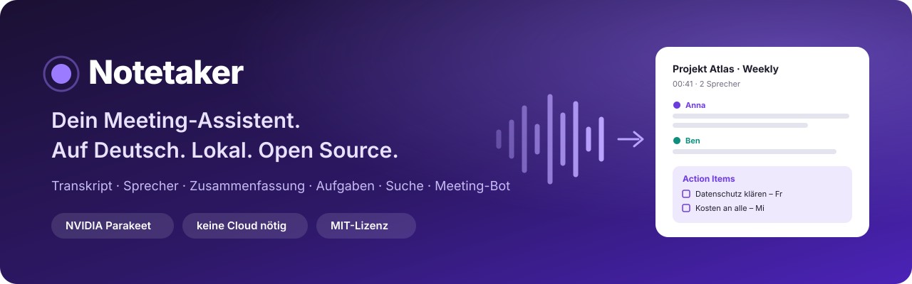
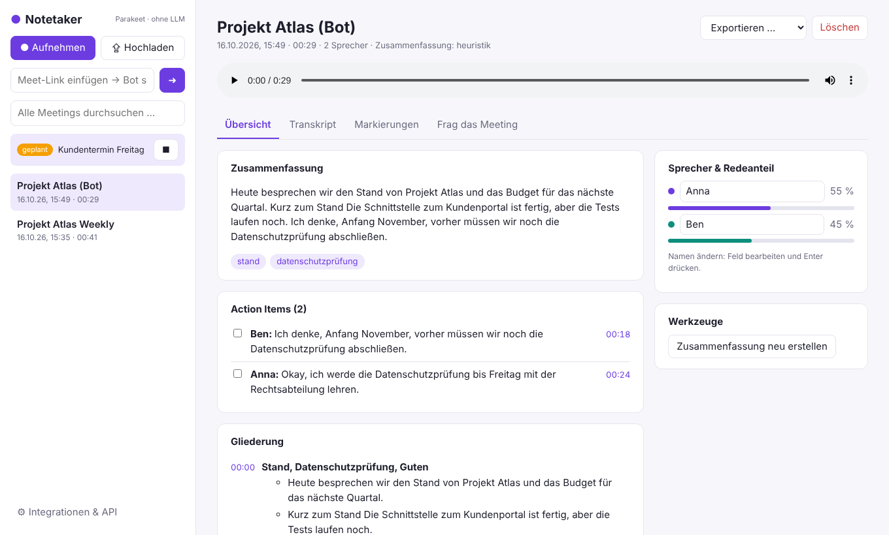
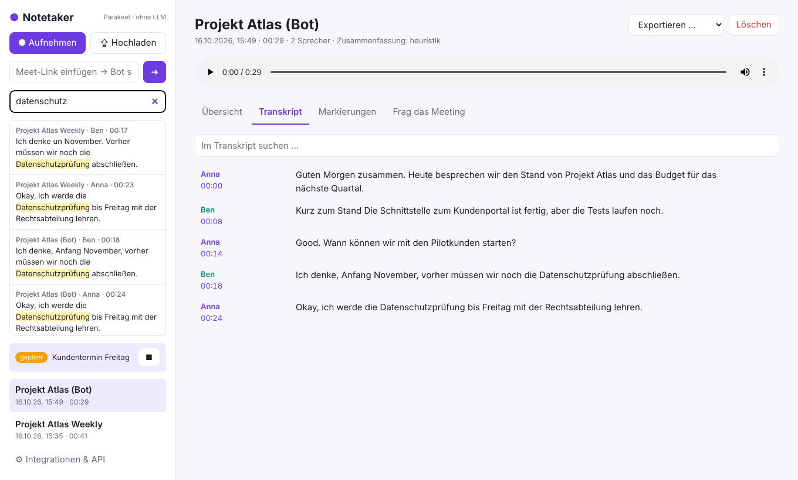
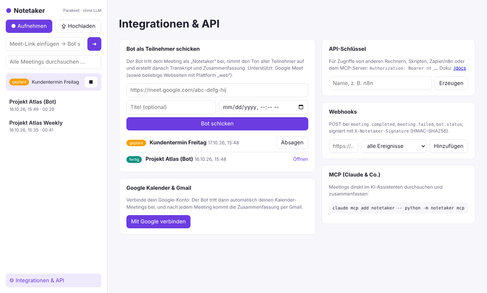
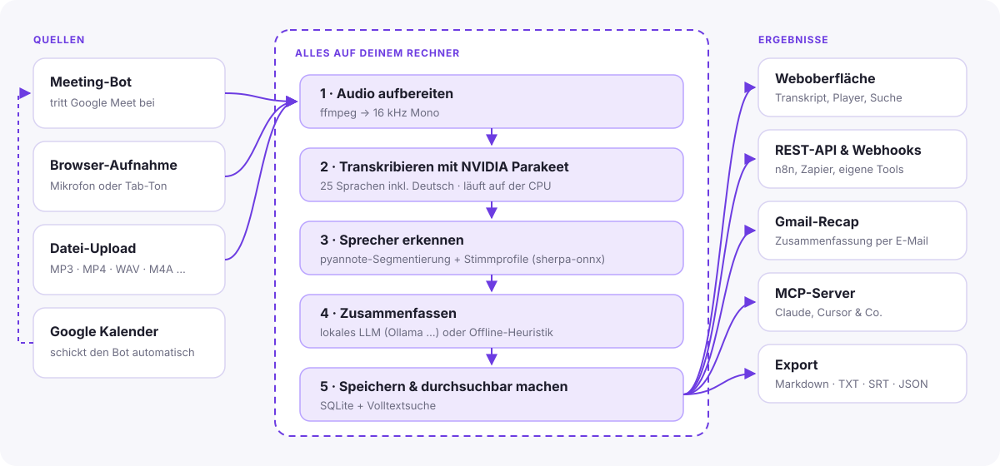

<p align="center">
  
</p>

<p align="center">
  <a href="LICENSE"></a>
  
  
  
  <a href="CONTRIBUTING.md"></a>
</p>

<p align="center">
  <a href="#-schnellstart">Schnellstart</a> ·
  <a href="#-funktionen">Funktionen</a> ·
  <a href="docs/einrichtung.md">Einrichtung</a> ·
  <a href="docs/api.md">API</a> ·
  <a href="docs/architektur.md">Architektur</a> ·
  <a href="docs/plan.md">Plan</a> ·
  <a href="CONTRIBUTING.md">Mitmachen</a> ·
  <a href="AGENTS.md">Für Coding-Agenten</a>
</p>

---

**Notetaker** schreibt deine Meetings mit, erkennt, wer spricht, fasst zusammen und sammelt die
Aufgaben ein – so wie [Fireflies.ai](https://fireflies.ai/), Otter oder tl;dv. Der Unterschied:
**Alles läuft auf deinem eigenen Rechner, auf Deutsch, und der Code ist offen.**
Kein Audio verlässt dein Gerät, kein Abo, keine Datenweitergabe an US-Clouds.

## 💡 Warum dieses Projekt?

Meeting-Assistenten sind enorm praktisch. Die bekannten Dienste schicken aber jedes Wort
deiner Besprechungen in eine fremde Cloud. Für Kundengespräche, Betriebsratssitzungen, Arztpraxen,
Kanzleien, Behörden oder einfach vertrauliche Team-Meetings ist das oft ein No-Go.

| | Notetaker | typische Cloud-Dienste |
|---|---|---|
| Wo landet das Audio? | **auf deinem Rechner** | Server des Anbieters |
| Deutsch | **von Grund auf** (Oberfläche, Zusammenfassungen, Modell) | oft nachrangig |
| Kosten | **kostenlos**, Open Source (MIT) | monatliches Abo pro Person |
| Offline nutzbar | **ja**, nach dem einmaligen Modell-Download | nein |
| Anpassbar & erweiterbar | **ja** – Code, API, Webhooks, MCP | nur über vorgegebene Integrationen |
| DSGVO | Daten verlassen das Gerät nicht* | Auftragsverarbeitung, Drittlandtransfer |

<sub>* Ausnahme: Funktionen, die du bewusst einschaltest, z. B. Google Kalender/Gmail oder ein entferntes LLM.</sub>

## ✨ Funktionen

<table>
<tr>
<td width="50%" valign="top">

**🎙️ Aufnehmen**
- **Meeting-Bot** tritt Google Meet als Teilnehmer bei – per Link oder automatisch aus dem Kalender
- Aufnahme im Browser: Mikrofon oder Ton eines Tabs (Zoom, Teams, Meet im Browser)
- Upload von MP3, MP4, WAV, M4A, WebM, OGG, FLAC …

**🧠 Verstehen**
- Transkription mit **NVIDIA Parakeet** (25 Sprachen inkl. Deutsch), läuft auf der CPU
- **Sprechererkennung** mit umbenennbaren Sprechern und Redeanteilen
- **Zusammenfassung**, Stichwörter, Gliederung, **Action Items**, Entscheidungen, offene Fragen
- **„Frag das Meeting“** – Fragen in natürlicher Sprache

</td>
<td width="50%" valign="top">

**🔎 Wiederfinden**
- Volltextsuche über alle Meetings, Klick springt an die Stelle im Audio
- Player mit mitlaufendem Transkript
- Soundbites, Kommentare und Aufgaben-Markierungen mit Zeitstempel
- Export als Markdown, TXT, SRT-Untertitel oder JSON

**🔌 Anbinden**
- **Google Kalender** (Auto-Join) und **Gmail** (Zusammenfassung per Mail)
- **REST-API** mit API-Schlüsseln und OpenAPI-Doku
- **Webhooks** (HMAC-signiert) für n8n, Zapier, Make & Co.
- **MCP-Server** für Claude, Cursor und andere KI-Assistenten

</td>
</tr>
</table>

## 🖼️ So sieht's aus

<p align="center">
  
</p>

<table>
<tr>
<td width="50%"></td>
<td width="50%"></td>
</tr>
<tr>
<td align="center"><sub>Transkript mit Sprechern und Suche über alle Meetings</sub></td>
<td align="center"><sub>Meeting-Bot, Google, API-Schlüssel, Webhooks, MCP</sub></td>
</tr>
</table>

## ⚙️ So funktioniert's

<p align="center">
  
</p>

Mehr dazu in der [Architektur-Übersicht](docs/architektur.md).

## 🚀 Schnellstart

Voraussetzungen: **Python 3.11+** und **ffmpeg**. Eine Grafikkarte ist nicht nötig.

```bash
git clone https://github.com/enving/kontextlayer_kommunikation.git
cd kontextlayer_kommunikation
python -m venv .venv && . .venv/bin/activate      # Windows: .venv\Scripts\activate
pip install -r requirements.txt
playwright install chromium                        # nur für den Meeting-Bot
python -m notetaker                                # → http://127.0.0.1:8000
```

Beim ersten Transkribieren lädt Notetaker die Modelle (~700 MB) einmalig herunter. Wer danach
komplett offline arbeiten will, lädt sie vorab: `python scripts/download_models.py`.

**Für richtig gute Zusammenfassungen** ein lokales Sprachmodell starten, z. B. mit
[Ollama](https://ollama.com): `ollama pull qwen2.5:7b-instruct` – Notetaker findet es automatisch.
Ohne LLM gibt es eine einfache, rein lokale Auswertung.

➡️ Alles Weitere – Meeting-Bot, Google Kalender & Gmail, Konfiguration – steht in
**[docs/einrichtung.md](docs/einrichtung.md)**, die API in **[docs/api.md](docs/api.md)**.

## 🧩 Technik

| Baustein | Projekt | Lizenz |
|---|---|---|
| Spracherkennung | [NVIDIA Parakeet TDT 0.6B v3](https://huggingface.co/nvidia/parakeet-tdt-0.6b-v3) über [onnx-asr](https://github.com/istupakov/onnx-asr) | CC-BY-4.0 (Modell), MIT |
| Sprachaktivität | [Silero VAD](https://github.com/snakers4/silero-vad) | MIT |
| Sprechererkennung | [sherpa-onnx](https://github.com/k2-fsa/sherpa-onnx) mit pyannote-Segmentierung 3.0 und 3D-Speaker ERes2Net | Apache-2.0 / MIT |
| Zusammenfassung | beliebiges lokales LLM mit OpenAI-kompatibler API (Ollama, llama.cpp, LM Studio, vLLM) | – |
| Meeting-Bot | [Playwright](https://playwright.dev/) + Chromium | Apache-2.0 |
| Server & Speicher | FastAPI, SQLite mit FTS5 | MIT / Public Domain |

Die Analyse des Vorbilds Fireflies.ai mit [REA](https://github.com/morluto/rea) steht in
[docs/fireflies-analyse.md](docs/fireflies-analyse.md).

## 🗺️ Roadmap

- [x] Transkription, Sprecher, Zusammenfassung, Suche, Export
- [x] Meeting-Bot für Google Meet, Google Kalender & Gmail
- [x] REST-API, Webhooks, MCP-Server
- [ ] Deutsches Modell **Parakeet primeline** und Server für **Dictate** (`/v1/audio/transcriptions`)
- [ ] Kalender aus **Outlook**, **CalDAV/ICS** (Nextcloud, iCloud, Thunderbird …)
- [ ] Recap per **SMTP** oder als **Entwurf** in Outlook/Thunderbird, Aufgaben-Export
- [ ] **Begleit-App** (aus Dictate) für Teams-/Zoom-Apps und Telefonate
- [ ] Meeting-Bot für **Jitsi**, **BigBlueButton**, **Microsoft Teams** und **Zoom**
- [ ] **Live-Transkript** während des Meetings
- [ ] Sprecher **wiedererkennen** über Meetings hinweg (Stimmprofile)
- [ ] **Docker**-Image und Installer für Windows/macOS
- [ ] Mehrbenutzer-Betrieb mit Teams und Freigaben

Wie das umgesetzt werden soll – Outlook, Thunderbird, Nextcloud, Desktop-Meetings und das
Zusammenspiel mit [Dictate](https://github.com/enving/dictate) – steht im
**[Plan](docs/plan.md)**. Ideen und Wünsche gerne als [Issue](https://github.com/enving/kontextlayer_kommunikation/issues).

## 🤝 Mitmachen

Jede Hilfe ist willkommen – Code, Tests mit echten Meetings, Übersetzungen, Doku, Ideen.
Wie das geht, steht in **[CONTRIBUTING.md](CONTRIBUTING.md)**. Kurz gesagt:

```bash
pip install -r requirements-dev.txt
pytest                  # läuft ohne Modelle und ohne Internet in Sekunden
```

**Du arbeitest mit einem Coding-Agenten** (Claude Code, Codex, Cursor, Copilot, Aider …)?
Dann zeig ihm **[AGENTS.md](AGENTS.md)** – dort steht alles, was ein Agent braucht, um sofort
loszulegen: Aufbau, Befehle, Konventionen und gute Einstiegsaufgaben.

## ⚖️ Rechtliches & Verantwortung

Notetaker ist ein Werkzeug. Wer Gespräche aufzeichnet, braucht in Deutschland grundsätzlich
die **Einwilligung aller Beteiligten** (§ 201 StGB, DSGVO). Der Meeting-Bot tritt deshalb
sichtbar unter seinem Namen bei. Sag zu Beginn eines Meetings Bescheid, dass mitgeschrieben wird.

## 📄 Lizenz

[MIT](LICENSE) – nutzen, ändern, weitergeben, auch kommerziell. Die eingesetzten Modelle haben
eigene Lizenzen (siehe [Technik](#-technik)); Parakeet v3 verlangt bei Weitergabe eine Namensnennung (CC-BY-4.0).
