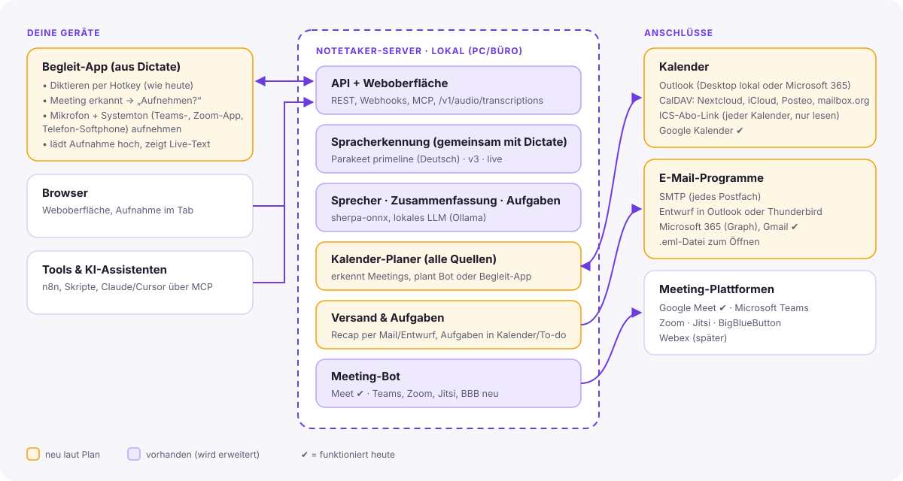

# Plan: Was als Nächstes gebaut wird

[← zurück zum README](../README.md) · Stand: Oktober 2026

Dieser Plan beschreibt, wie Notetaker vom „Meeting-Assistenten für Google Meet“ zu einem
lokalen Assistenten wird, der **mit den Programmen arbeitet, die Leute wirklich benutzen**:
Outlook, Thunderbird, Nextcloud, Teams- und Zoom-Desktop-Apps, Telefonate. Außerdem soll er
mit **[Dictate](https://github.com/enving/dictate)** zusammenwachsen, dem kleinen Diktierprogramm,
das schon dasselbe Sprachmodell verwendet.

<p align="center"></p>

## Inhalt

1. [Ausgangslage](#1-ausgangslage)
2. [Zielbild](#2-zielbild)
3. [Wie es im Alltag ablaufen soll](#3-wie-es-im-alltag-ablaufen-soll)
4. [Arbeitspakete](#4-arbeitspakete)
5. [Reihenfolge](#5-reihenfolge)
6. [Offene Entscheidungen](#6-offene-entscheidungen)

---

## 1. Ausgangslage

**Notetaker kann heute:** Upload und Browser-Aufnahme, Transkription mit Parakeet v3,
Sprechererkennung, Zusammenfassung mit lokalem LLM, Suche, Export, einen Bot für **Google Meet**,
**Google Kalender** (Auto-Join) und **Gmail** (Recap), REST-API, Webhooks und MCP.

**Dictate kann heute:** Hotkey halten, sprechen, loslassen – der Text wird dort getippt, wo der
Cursor steht. Es läuft auf Linux (X11 und Wayland), Windows und macOS, mit Tray-Symbol und
Einstellungen (PyQt6). Für die lokale Erkennung nutzt es **Parakeet primeline**, eine
**deutsche Nachschulung** von Parakeet v3 (int8, sherpa-onnx), mit einigen guten Lösungen:
lange Aufnahmen an Pausen teilen (Modellgrenze 400 s), leise Aufnahmen vorher verstärken,
leer erkannte Stücke in 20-s-Teilen erneut versuchen. Außerdem kann Dictate an einen
**Heimserver** senden: `POST {basis}/v1/audio/transcriptions` mit `Authorization: Bearer …`
(OpenAI-kompatibel).

**Was fehlt:**

| Lücke | Warum sie wichtig ist |
|---|---|
| Kalender außer Google | In Firmen und Behörden laufen Termine fast immer über **Outlook/Exchange**, privat oft über Nextcloud, iCloud oder Thunderbird. |
| E-Mail außer Gmail | Recaps sollen aus dem eigenen Postfach kommen – oder als **Entwurf** im eigenen Mailprogramm landen, damit man vor dem Senden drüberschauen kann. |
| Meetings in Desktop-Apps | Viele nutzen die **Teams- oder Zoom-App**, nicht den Browser. Ein Bot ist dort oft nicht erlaubt oder unerwünscht. |
| Teams, Zoom, Jitsi, BigBlueButton | Der Bot kann bisher nur Google Meet. In Deutschland sind **Teams**, **Jitsi** und **BigBlueButton** (Schulen, Verwaltung) sehr verbreitet. |
| Deutsch-Qualität | Parakeet v3 macht bei kurzen deutschen Einwürfen Fehler („Danke“ → „Tá?“). Dictates deutsches Modell ist dafür besser geeignet. |
| Zwei getrennte Projekte | Notetaker und Dictate laden jeweils ihr eigenes Modell und können nichts voneinander nutzen. |

## 2. Zielbild

Drei Bausteine (siehe Grafik oben):

1. **Notetaker-Server** – läuft auf dem eigenen PC oder auf einem Rechner im Büro/zu Hause.
   Er bündelt Spracherkennung, Sprecher, Zusammenfassung, Speicher, Kalender-Planer und Versand.
   **Eine Spracherkennung für alle Geräte**, auch für Dictate.
2. **Begleit-App** – entsteht aus **Dictate**. Sie bleibt das Diktier-Werkzeug und lernt dazu:
   Meetings erkennen, Mikrofon **und Systemton** aufnehmen (für Teams-/Zoom-Apps, Softphones),
   an den Server schicken. Sie kann auch alleine (offline, ohne Server) diktieren wie bisher.
3. **Anschlüsse** – Kalender (Outlook, CalDAV, ICS, Google), E-Mail (SMTP, Entwurf in
   Outlook/Thunderbird, Microsoft 365, Gmail) und Meeting-Plattformen (Bot).

Grundsätze bleiben: **deutsch, lokal, offen**. Jeder Anschluss ist optional; ohne Internet
funktioniert alles außer den Cloud-Anschlüssen.

### Zwei Wege in ein Meeting

| | **Bot** (heute: Google Meet) | **Begleit-App** (neu) |
|---|---|---|
| Wie | Ein eigener Browser tritt dem Meeting als Teilnehmer „Notetaker“ bei | Die App auf deinem Rechner nimmt Mikrofon + Systemton auf |
| Für | Browser-Meetings: Meet, Teams (Web), Zoom (Web), Jitsi, BBB | **alles**, was über deinen Rechner läuft: Teams-/Zoom-App, Webex, Telefonate, Präsenzmeetings |
| Du musst dabei sein | nein | ja (es läuft auf deinem Gerät) |
| Sprecher | über Stimmen erkannt | über Stimmen; zusätzlich „ich“ (Mikrofon) vs. „die anderen“ (Systemton) getrennt |
| Hürden | Einlass durch Gastgeber, Bot-Sperren der Plattform | Systemton-Zugriff je Betriebssystem |
| Transparenz | Bot ist für alle sichtbar | App fragt vor jeder Aufnahme nach und erinnert daran, die Runde zu informieren |

Beide Wege landen in derselben Verarbeitung und Oberfläche.

## 3. Wie es im Alltag ablaufen soll

**A – Teams-Termin aus Outlook, Teilnahme über die Teams-App**
1. Der Kalender-Planer liest den Termin aus Outlook (lokal oder Microsoft 365).
2. Eine Minute vor Beginn meldet sich die Begleit-App: *„Team-Weekly beginnt – aufnehmen?“*
3. Klick auf „Aufnehmen“. Mikrofon und Systemton werden aufgenommen, ein Live-Transkript erscheint.
4. Das Meeting endet (Teams-Fenster zu oder Termin vorbei) – die App fragt *„Aufnahme beenden?“*.
5. Der Server erstellt Transkript, Sprecher, Zusammenfassung und Aufgaben.
6. Ein **Entwurf** mit dem Recap öffnet sich in Outlook, adressiert an die Termin-Teilnehmer.
   Aufgaben landen auf Wunsch in Outlook-Aufgaben bzw. als CalDAV-Aufgaben.

**B – Jitsi-/BBB-Termin aus Nextcloud, ohne dabei zu sein**
1. Der Kalender-Planer liest den Termin per CalDAV und findet den Jitsi-Link.
2. Der Bot tritt eine Minute vorher bei und nimmt auf.
3. Danach geht der Recap per SMTP an dich (und optional an alle Teilnehmenden).

**C – Telefonat oder Präsenztermin**
1. In der Begleit-App „Gespräch aufnehmen“ (oder Hotkey) – nur Mikrofon bzw. Softphone-Ton.
2. Ergebnis wie oben, ohne Kalender.

**D – Diktieren wie bisher, aber mit dem Server**
Dictate schickt die Aufnahme an den Notetaker-Server statt an Groq/OpenAI. Kein Modell auf dem
Laptop nötig, gleiche deutsche Erkennung überall.

## 4. Arbeitspakete

Aufwand grob: **S** = bis 2 Tage, **M** = bis 1 Woche, **L** = mehr als 1 Woche.

### AP1 – Gemeinsame Spracherkennung mit Dictate (S–M) ⭐ zuerst

**Ziel:** Notetaker nutzt das deutsche Modell aus Dictate, und Dictate kann Notetaker als Server nutzen.

- Neue Engine `SherpaParakeetTranscriber` in `speech.py` für **parakeet-primeline** (sherpa-onnx,
  feste Hugging-Face-Revision wie in Dictate). Wort-Zeitstempel kommen aus `result.timestamps`/`tokens`.
- Dictates Erkenntnisse übernehmen: an Pausen teilen (≤ 90 s), Pegel anheben, leere Stücke in
  20-s-Teilen wiederholen. Am besten als kleines **gemeinsames Paket** (z. B. `parakeet-de`), das
  beide Projekte einbinden – statt Code zu kopieren.
- Einstellung `NOTETAKER_ASR_MODEL=parakeet-primeline` (Standard für Deutsch), v3 bleibt für
  andere Sprachen.
- Neuer Endpunkt **`POST /v1/audio/transcriptions`** (OpenAI-kompatibel, `response_format`
  `text`/`json`/`verbose_json`) mit Notetaker-API-Schlüssel. Damit funktioniert Dictates
  Heimserver-Anbieter ohne Änderung; in Dictate kommt ein eigener Eintrag „Notetaker“ dazu.

**Fertig, wenn:** der Testdialog mit primeline weniger Fehler hat als mit v3 (Wortfehlerrate
messen), Dictate über Notetaker diktiert, Tests für den neuen Endpunkt grün sind.

### AP2 – Kalender-Anschlüsse für alle (M) ⭐

**Ziel:** Termine aus jedem gängigen Kalender – ohne Google-Pflicht.

- Gemeinsame Schnittstelle `CalendarSource.events(von, bis) → [Termin]` mit
  Titel, Beginn, Ende, Teilnehmenden, Meeting-Link, eigener Zusage. Der heutige
  `CalendarScheduler` arbeitet dann mit **beliebig vielen Quellen**.
- Quellen in dieser Reihenfolge:

| Quelle | Für | Technik | Hinweise |
|---|---|---|---|
| **ICS-Abo-Link** | jeden Kalender (Outlook „Kalender veröffentlichen“, Google „geheime iCal-Adresse“, Nextcloud, iCloud) | `icalendar` + `recurring-ical-events` | nur lesen, einfachster Einstieg, Serien-Termine beachten |
| **CalDAV** | Nextcloud, iCloud, Posteo, mailbox.org, Fastmail, Thunderbird-Kalender auf CalDAV | `caldav` | Benutzername + App-Passwort; kann auch Aufgaben (VTODO) schreiben |
| **Outlook lokal (Windows)** | klassisches Outlook-Desktop mit Exchange oder PST | COM über `pywin32` (`Outlook.Application`) | ganz ohne Cloud-Registrierung; das **neue** Outlook für Windows kann kein COM |
| **Microsoft 365 / Exchange Online** | neues Outlook, Outlook im Web, Teams-Termine | Microsoft Graph, Anmeldung per Gerätecode | einmalig eine App in Entra ID registrieren; Rechte `Calendars.Read`, `Mail.Send` |
| **Exchange lokal (On-Premises)** | Firmen mit eigenem Exchange | EWS über `exchangelib` | |
| **macOS-Kalender** | Apple Kalender (enthält oft alle Konten) | EventKit über `pyobjc` | gehört in die Begleit-App, nicht auf den Server |

- Einstellungsseite „Kalender“: Quellen hinzufügen, testen, pro Quelle wählen: *Bot schicken*,
  *Begleit-App fragen* oder *nichts tun*.
- Meeting-Links erkennen für Meet, Teams, Zoom, Jitsi (`meet.jit.si` und eigene Instanzen per
  Einstellung), BBB, Webex.

**Fertig, wenn:** ICS und CalDAV mit einem echten Nextcloud-Kalender getestet sind (Tests mit
nachgebautem Server bzw. ICS-Dateien inkl. Serien und Zeitzonen), Outlook-COM auf Windows
manuell geprüft ist.

### AP3 – E-Mail und Aufgaben in die eigenen Programme (S–M) ⭐

**Ziel:** Recaps und Aufgaben dort, wo man ohnehin arbeitet – am liebsten als **Entwurf**.

- Gemeinsame Schnittstelle `MailSender.send(...)` bzw. `.draft(...)`.

| Weg | Wie | Nutzen |
|---|---|---|
| **SMTP** | `smtplib`, STARTTLS/SSL, App-Passwort | funktioniert mit jedem Postfach (GMX, Web.de, Posteo, Firmen-Exchange …) |
| **Outlook-Entwurf (Windows)** | COM: `CreateItem(0)`, `Display()` | Recap öffnet sich fertig in Outlook, man klickt nur noch „Senden“ |
| **Thunderbird-Entwurf** | Kommandozeile `thunderbird -compose "to=…,subject=…,body=…"` | funktioniert auf allen Systemen, auf denen Thunderbird installiert ist |
| **Microsoft 365** | Graph `sendMail` oder Entwurf unter `messages` | für das neue Outlook |
| **.eml-Datei** | Download-Knopf in der Oberfläche | öffnet sich in jedem Mailprogramm |
| **Gmail** | vorhanden | |

- **Aufgaben exportieren:** Action Items als CalDAV-Aufgaben (Nextcloud, Thunderbird),
  Outlook-Aufgaben (COM/Graph) oder `.ics` mit VTODO. Mit Verweis zurück auf die Stelle im Meeting.
- Recap-Vorlage einheitlich (HTML + Text), auf Deutsch, mit Link zur Aufnahme.

**Fertig, wenn:** Recap per SMTP und als Thunderbird-/Outlook-Entwurf kommt, Aufgaben als VTODO
in Nextcloud erscheinen.

### AP4 – Begleit-App aus Dictate (L) ⭐

**Ziel:** Meetings in Desktop-Apps und Telefonate aufnehmen – ohne Bot.

- **Ausgangspunkt Dictate** (Tray, Hotkeys, Einstellungen, Audio, Windows/macOS/Linux schon da).
  Neuer Modus „Meeting aufnehmen“ neben „Diktieren“.
- **Systemton aufnehmen**, getrennt vom Mikrofon (zwei Spuren → bessere Sprechertrennung):
  - Linux: PipeWire/PulseAudio-„Monitor“-Quelle
  - Windows: WASAPI-Loopback (z. B. `soundcard` oder `PyAudioWPatch`)
  - macOS: ScreenCaptureKit (ab macOS 13) über `pyobjc`; als Notlösung BlackHole
- **Meeting erkennen:** Termin aus dem Kalender-Planer des Servers *oder* lokal: Teams-/Zoom-/Webex-
  Prozess aktiv und Mikrofon in Benutzung → Hinweis *„Meeting erkannt – aufnehmen?“*.
  **Nie automatisch ohne Klick aufnehmen.**
- Aufnahme in Stücken hochladen (bricht die Verbindung ab, geht nichts verloren), Server setzt
  zusammen. Ohne Server: lokal zwischenspeichern und später senden.
- Live-Transkript im kleinen Fenster (siehe AP6).
- Kopplung mit dem Server per QR-Code oder Schlüssel aus „Integrationen & API“.

**Fertig, wenn:** ein Teams-App-Meeting auf Windows und ein Zoom-App-Meeting auf Linux
vollständig aufgenommen und mit „ich“/„andere“ getrennt verarbeitet werden.

### AP5 – Bot für weitere Plattformen (M je Plattform)

Reihenfolge nach Verbreitung und Machbarkeit:

1. **Jitsi** – offen, Beitritt ohne Konto, einfach. Eigene Instanzen per Einstellung.
2. **BigBlueButton** – offen, „Nur zuhören“ beim Beitritt wählen.
3. **Microsoft Teams (Web)** – Gastbeitritt „Im Browser fortfahren“, Name setzen, Lobby abwarten.
   Klappt nur, wenn die Organisation anonymen Beitritt erlaubt; sonst Begleit-App.
4. **Zoom (Web)** – „Über Browser beitreten“. Offiziell verlangt Zoom für Bots das Meeting-SDK mit
   eigener App-Freigabe; der Browser-Weg kann gesperrt sein → Begleit-App als Rückfallebene.
5. **Webex** – später.

Der Ton-Mitschnitt (`capture.js`) bleibt gleich; je Plattform kommt nur ein Adapter dazu
(siehe [AGENTS.md](../AGENTS.md#typische-aufgaben--so-gehts)). Zusätzlich: **Teilnehmernamen
aus der Oberfläche** der Plattform auslesen, um Sprecher automatisch zu benennen.

### AP6 – Live-Transkript (M)

- Server nimmt Audio-Stücke per WebSocket an (Bot, Begleit-App, Browser) und transkribiert
  fortlaufend in kurzen Fenstern; das endgültige Transkript entsteht wie heute nach dem Ende.
- Oberfläche zeigt laufenden Text; „Frag das Meeting“ funktioniert schon während des Meetings.

### AP7 – Einfache Installation (M)

- **Docker-Image** (Server inkl. ffmpeg und Chromium) und `docker compose` mit Ollama.
- **Installer** für Windows/macOS für die Begleit-App (aus Dictate), Server optional mitinstallierbar.
- Erststart-Assistent: Modell laden, Sprache wählen, Kalender/E-Mail verbinden.

### AP8 – Mehrere Nutzer im Büro (L, später)

- Benutzerkonten, eigene Meetings je Person, Freigabe an Kollegen oder Teams.
- Anmeldung über vorhandene Konten (z. B. Nextcloud oder Microsoft) optional.
- Rollen und Löschfristen (z. B. Aufnahmen nach 30 Tagen löschen, Transkript behalten).

## 5. Reihenfolge

```
Phase 1  ─ AP1 Spracherkennung mit Dictate teilen     ─┐
(Basis)    AP2 Kalender: ICS + CalDAV                  ├─ ohne Microsoft-Konto nutzbar
           AP3 E-Mail: SMTP + Thunderbird-/eml-Entwurf ─┘

Phase 2  ─ AP2 Outlook (COM lokal, Graph)             ─┐
(Büro)     AP3 Outlook-Entwurf, Aufgaben-Export        ├─ Outlook-Welt komplett
           AP5 Bot: Jitsi, BBB, Teams-Web             ─┘

Phase 3  ─ AP4 Begleit-App (Systemton, Meeting-Hinweis)─┐
(Desktop)  AP6 Live-Transkript                         ├─ jede Meeting-App, auch Telefonate
           AP7 Docker + Installer                     ─┘

Phase 4  ─ AP5 Zoom/Webex, AP8 Mehrbenutzer
```

Warum so: **Phase 1** bringt sofort spürbaren Nutzen (bessere deutsche Erkennung, Kalender und
Mail ohne Google) mit wenig Risiko. **Phase 2** öffnet die Outlook-Welt, in der die meisten
Firmen arbeiten. **Phase 3** ist der größte Brocken, macht Notetaker aber unabhängig von
Bot-Sperren und Plattformen.

Jedes Arbeitspaket wird als eigenes GitHub-Issue angelegt und kann von Menschen oder
Coding-Agenten (siehe [AGENTS.md](../AGENTS.md)) unabhängig umgesetzt werden.

## 6. Offene Entscheidungen

| Frage | Optionen | Vorschlag |
|---|---|---|
| **Projektname** | „Notetaker“ behalten oder deutscher Name, z. B. **Mitschrift**, **Protokollant**, **Gesprächsnotiz**, **Sitzungsschreiber** | gemeinsam entscheiden; bei Umbenennung GitHub-Repo umbenennen (GitHub leitet alte Links weiter) und Doku/Grafiken anpassen |
| **Dictate und Notetaker** | getrennte Repos mit gemeinsamem Paket `parakeet-de` – oder ein Monorepo | getrennt lassen, gemeinsames Paket; Dictate bleibt schlank und eigenständig nutzbar |
| **Standardmodell** | primeline (Deutsch) oder v3 (25 Sprachen) | primeline als Standard, v3 bei anderer Sprache automatisch bzw. per Einstellung |
| **Dictate ist ein Fork** von `winidi/dictate` | Änderungen nur im eigenen Fork oder auch zurückgeben | allgemein nützliche Verbesserungen als Pull Request an das Original anbieten |
| **Microsoft-Anbindung** | Graph braucht eine App-Registrierung in Entra ID | Anleitung schreiben; COM für klassisches Outlook ohne Registrierung zuerst |
